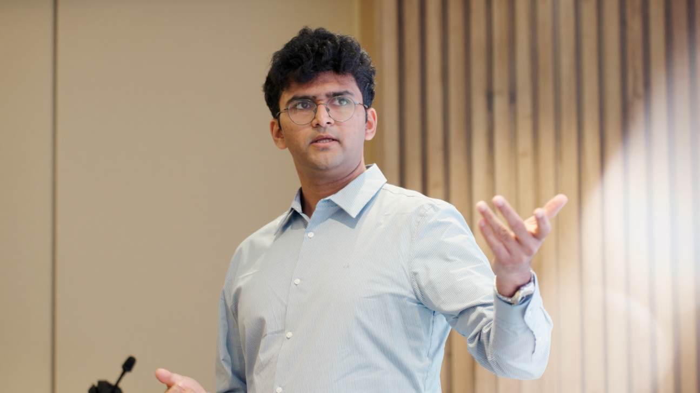

<!-- ## About Me -->

  

The goal of life, the Dalai Lama said, is to walk into a room and be loved by all who are there.
{: .hidden-line}

Hi, I'm Surya Narayanan Hari. I am working toward a PhD at Caltech. Before this, I worked at Dana Farber Cancer Institute and did my undergrad at Stanford.

[X](https://x.com/EcstaticIndian) | [LinkedIn](https://www.linkedin.com/in/suryanarayanan21/)

<!-- Please fill out this form before we proceed: [https://forms.gle/SuPzCBeXCB26Zexa7](https://forms.gle/SuPzCBeXCB26Zexa7) -->

<!-- ## To do
Add a [bibbase](https://bibbase.org/start) -->
